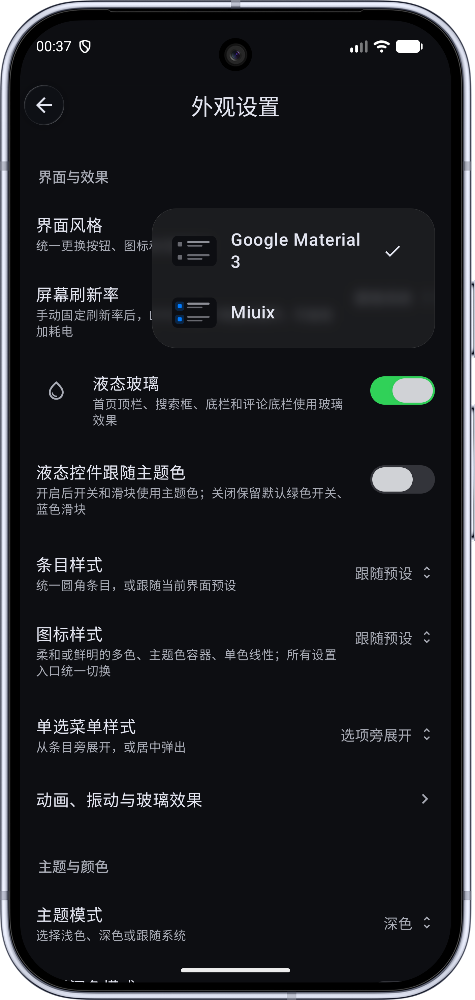

# **BiliPai魔改，仅为个人使用，折叠屏体验优化**

本仓库是 [jay3-yy/BiliPai](https://github.com/jay3-yy/BiliPai) 的个人 fork，工作分支为 `mymain`（`main` 仅同步上游），当前已同步上游稳定版 **v0.6.8**。相对上游的主要改动：

- **折叠屏 / 平板视频页**：近正方形内屏下的播放器高度、状态栏避让、信息页与评论页侧边栏（可左右滑动切换）、完整可读的「更多推荐」卡片；标题与 UP 主同行的头部布局，折叠时只显示标题与数据，联合投稿、合集与分P选择收进展开详情；标签可直接搜索。
- **弹幕**：直播弹幕沿用视频弹幕的全屏/竖屏设置并修复不显示的问题。
- **播放**：长按 2 倍速通过 AudioTrack 变速，起播更顺畅；双击快进/快退在点击一侧显示白色 +N/-N 文字（含竖屏与离线播放器）；新增「显示发现音乐」开关，默认关闭。
- **列表与首页**：所有评论列表使用紧凑间距；「定位上次刷新」与「撤销刷新」可单独开关、固定在右下角并在滚动时自动消失；回到顶部改为连续平滑滚动；大屏下首页、收藏夹与每周必看占满窗口宽度；折叠屏外屏首页双列与搜索结果保持两列；移除底栏与侧栏的侧边导航切换图标。
- **搜索**：搜索历史显示为更高的色块，长按填充删除，不再使用删除按钮。
- **稳定性**：修复 Retrofit 服务存于 static final 字段时的 ART JIT 崩溃（含上游新增的仓库）。
- **发布**：检查更新指向本 fork 的 Release，发布 APK 使用独立签名，由 `scripts/publish_fork_release.sh` 发布。

<div align="center">


# BiliPai

**原生、纯净、可扩展的第三方 BiliBili Android 客户端**

[简体中文](README.md) · [English](README_EN.md)


[下载](#下载与安装) · [Wiki](https://github.com/jay3-yy/BiliPai/wiki) · [Telegram 频道](https://t.me/bilipai666) · [Telegram 交流群](https://t.me/bilipai888/1)

</div>

基于 Kotlin 与 Jetpack Compose 打造，支持视频、番剧、直播、动态、消息与离线缓存，适配手机、平板与折叠屏。

## 主要功能

| 功能 | 说明 |
| --- | --- |
| 视频播放 | DASH、高清画质、弹幕、手势、倍速、播放记忆、后台播放与画中画 |
| 听视频 | 沉浸式与黑胶模式、歌词、队列、定时关闭、系统媒体控制 |
| 字幕与笔记 | 本地字幕导入导出、样式与时间调整；私有笔记、时间点与 AI 总结草稿 |
| 番剧与直播 | 追番、选集、进度预览、直播分区与实时弹幕 |
| 动态与消息 | 关注动态、评论回复、图片预览与私信 |
| 搜索与缓存 | 视频、UP 主与番剧搜索；离线下载、断点续传与本地播放 |
| 外观与布局 | Google Material 3、Miuix、可选液态玻璃、动态取色与大屏布局 |
| 扩展能力 | 插件、DLNA / Google Cast 投屏、WebDAV 设置备份 |

部分画质需要登录或相应账号权限。外观、播放、弹幕与后台行为可在设置中调整。

## 界面预览

<div align="center">

**液态玻璃设计，贯穿全局**

截图仅展示部分界面下的液态玻璃效果。





</div>

界面随版本、主题和设备尺寸有所不同。

截图之外，应用还提供弹幕轻触快捷操作、竖屏上滑全屏与动态环境光、听视频、AI 总结笔记、字幕导入导出、插件扩展、DLNA / Google Cast 投屏与 WebDAV 设置备份等；部分功能与 Android 版本相关。

## 下载与安装

从 [Telegram 频道](https://t.me/bilipai666) 获取安装包与发布说明，交流反馈可加入 [Telegram 群组](https://t.me/bilipai888/1)。

- 系统要求：Android 8.0+
- 登录方式：TV 扫码、密码、短信验证码或 Cookie 导入
- 安装 APK 时需允许对应来源安装应用

## 插件

内置空降助手、去广告、Anime4K、弹幕增强、夜间护眼、推荐与投屏等 12 个插件，支持 JSON / `.bp` 规则通过 URL 导入。

导入第三方插件前，请检查来源与权限声明。插件开发见 [plugin-sdk](plugin-sdk)。

## 最近更新

- 竖屏播放支持上滑进入全屏，留白处显示动态环境光；弹幕轻触即可点赞、复制或举报。
- 直播弹幕新增字体、行高等高级设置，输入框支持表情与富文本编辑。
- 听视频更可靠地记忆播放进度；个人中心新增硬币、经验明细与更多隐私设置。

完整记录见 [CHANGELOG.md](CHANGELOG.md)。

## 构建

环境：JDK 21、Android SDK 37。

```bash
git clone https://github.com/jay3-yy/BiliPai.git
cd BiliPai
./gradlew :app:assembleDev
```

Miuix 依赖从 GitHub Packages 获取，需在本机 `~/.gradle/gradle.properties` 配置 `gpr.user`、`gpr.key`（或设置 `GITHUB_ACTOR`、`GITHUB_TOKEN`）。APK 输出至 `app/build/outputs/bilipai/dev/`。`app/google-services.json` 为可选配置，缺失时跳过 Firebase。

## 参与贡献

欢迎通过 [Issue](https://github.com/jay3-yy/BiliPai/issues/new/choose) 反馈问题、提出建议，也欢迎提交 [Pull Request](https://github.com/jay3-yy/BiliPai/pulls)，一起完善功能和翻译。

## 致谢

- [Kotlin](https://kotlinlang.org/) — 开发语言与协程
- [Jetpack Compose](https://developer.android.com/jetpack/compose) — 声明式 UI 框架
- [AndroidX Media3](https://github.com/androidx/media) — Media3 / ExoPlayer 播放引擎
- [FFmpeg](https://ffmpeg.org/) — 音频解码
- [Room](https://developer.android.com/training/data-storage/room) / [DataStore](https://developer.android.com/topic/libraries/architecture/datastore) — 本地数据与偏好存储
- [Retrofit](https://github.com/square/retrofit) / [OkHttp](https://github.com/square/okhttp) — 网络请求
- [Coil](https://github.com/coil-kt/coil) — 图片加载
- [Lottie](https://github.com/airbnb/lottie-android) — 矢量动画
- [MaterialKolor](https://github.com/jordond/MaterialKolor) — 动态主题配色
- [Compose Rich Editor](https://github.com/MohamedRejeb/Compose-Rich-Editor) — 富文本编辑
- [DanmakuRenderEngine](https://github.com/bytedance/DanmakuRenderEngine) — 弹幕渲染引擎
- [BiliBili-API-collect](https://github.com/SocialSisterYi/bilibili-API-collect) — B 站 API 文档
- [BiliBiliSponsorBlock](https://github.com/hanydd/BilibiliSponsorBlock) — 空降助手数据与 API
- [Miuix](https://github.com/compose-miuix-ui/miuix) — 界面组件库
- [Haze](https://github.com/chrisbanes/haze) — 毛玻璃效果
- [PiliPlus](https://github.com/bggRGjQaUbCoE/PiliPlus) — 全局应用交互参考
- [Bili Pilot](https://github.com/siwei-yuan/bili-pilot) — CDN 选线参考

其余依赖与来源见 [第三方声明](THIRD_PARTY_NOTICES.md)。

## 许可证与声明

本项目采用 [GPLv3](LICENSE)。分发时请遵守许可证，提供对应源代码并保留版权声明。

本项目为非官方客户端，与 BiliBili 无隶属关系。内容版权归对应权利方所有，使用时请遵守相关法律法规与平台规则。登录信息保存在本地；使用统计可在设置中管理。

<div align="center">

<sub>源码版本 0.6.8（530） · 更新于 2026-10-29 · Made by [YangY](https://x.com/YangY_0x00)</sub>

</div>
